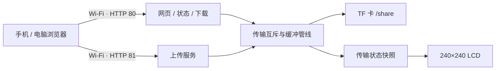

# 架构

浏览器连接开发板 SoftAP 后，通过端口 80 获取网页、图片、状态、文件列表和下载内容。上传走端口 81 的 ESP-IDF HTTP 服务，以二进制请求体直接传输文件。

上传使用两个 32 KiB 内部 DMA RAM 缓冲，使接收与写卡重叠。文件先写独立临时路径，完成同步、关闭、重命名及大小验证后返回成功。同名文件添加编号，保留原文件。网页收到成功响应后再查询目录，确认名称与大小。

下载使用分块预读。64 MiB 内由网页流式接收、更新共用进度条，完成后创建 Blob 并交给浏览器保存；这一路径会占用浏览器内存。更大的文件使用原生下载，进度由浏览器或系统下载器管理。

存储维护、上传和下载通过互斥保护。TF 健康检查包含目录、写入、同步、重命名和读回；失败时后台重试，不自动格式化。LCD 从状态快照读取传输信息，网页图片和屏幕图片分别打包。

删除接口 `DELETE /api/files?name=...` 仅允许 `/share` 下合法名称的普通文件，拒绝路径分隔符，并与传输互斥；没有网页删除按钮。`/api/lab-file` 仅删除命名符合约定的测试文件。接口未设置独立账户权限，连接热点的客户端属于同一信任范围。

`features.h` 默认关闭距离测速。部分实验诊断接口仍保留，常规使用无需调用。
