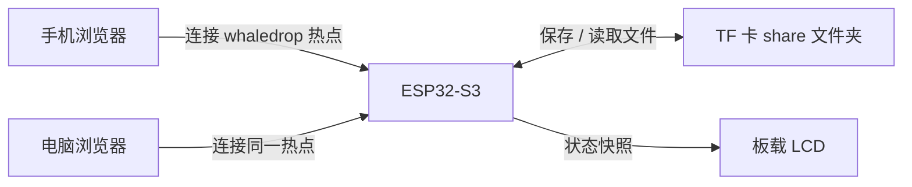
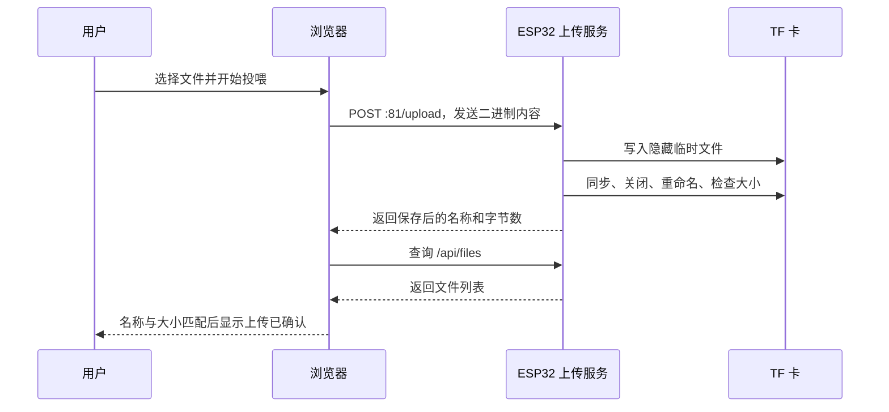
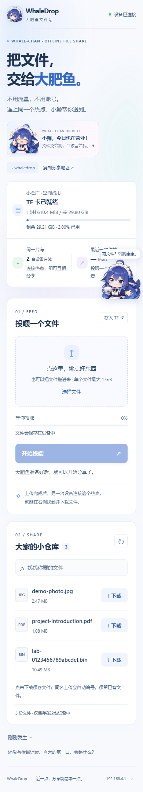

# WholeDrop 鲸鱼娘离线文件站：完整原理与使用手册

> 文档日期：2026-10-28。依据当前仓库的固件、网页和测试脚本编写，面向第一次接触本项目、ESP32 或局域网文件共享的读者。仓库名称是 WholeDrop，现有网页名称是 WhaleDrop / 大肥鱼文件站，热点名称是 whaledrop，三者指向同一个项目。
>
> 本文描述当前实现，不代表文中列出的所有操作系统、手机型号和异常场景都已逐一实测。已验证范围见第 16 节。距离测速入口已关闭。

## 阅读导航

- [1. 项目是什么](#1-项目是什么)
- [2. 先认识几个概念](#2-先认识几个概念)
- [3. 硬件组成与文件保存位置](#3-硬件组成与文件保存位置)
- [4. 文件为什么能在离线时传输](#4-文件为什么能在离线时传输)
- [5. 第一次使用的完整流程](#5-第一次使用的完整流程)
- [6. 网页逐区说明](#6-网页逐区说明)
- [7. 上传的完整过程](#7-上传的完整过程)
- [8. 下载的完整过程](#8-下载的完整过程)
- [9. 电脑与手机如何适配](#9-电脑与手机如何适配)
- [10. 鲸鱼娘的状态与互动](#10-鲸鱼娘的状态与互动)
- [11. 板载屏幕显示什么](#11-板载屏幕显示什么)
- [12. 状态刷新与多设备协作](#12-状态刷新与多设备协作)
- [13. 速度与容量数字怎么理解](#13-速度与容量数字怎么理解)
- [14. 可靠性与存储恢复原理](#14-可靠性与存储恢复原理)
- [15. 限制与使用边界](#15-限制与使用边界)
- [16. 已验证内容与证据边界](#16-已验证内容与证据边界)
- [17. 常见问题与排查](#17-常见问题与排查)
- [18. 面向维护者的实现说明](#18-面向维护者的实现说明)
- [19. 演示与验收清单](#19-演示与验收清单)
- [20. 术语速查与代码索引](#20-术语速查与代码索引)

## 1. 项目是什么

WholeDrop 是一个放在 ESP32-S3 开发板上的小型离线文件站。开发板自己建立 Wi-Fi 热点，手机、电脑连接该热点后，通过普通浏览器打开设备网页，就可以上传或下载文件。

它可以理解为一只带 Wi-Fi 和小屏幕的“共享文件盒子”：

- ESP32-S3 负责提供无线连接、网页和文件传输服务。
- TF 卡负责长期保存文件。
- 手机或电脑的浏览器负责选择文件、发起传输和显示操作结果。
- 板载小屏幕负责在设备本体上显示运行状态。
- 鲸鱼娘角色把等待、工作、完成、恢复等状态转换成更直观的图像与文字，也提供独立的点击互动。

典型场景是：手机把照片上传到盒子，电脑再从盒子下载照片。此时手机和电脑不需要相互配对，也不需要把照片发送到互联网服务器。

### 1.1 一个具体例子

小明用手机拍了一张照片，想交给旁边的小红：

1. 两人都连接 `whaledrop` 热点。
2. 小明打开 `http://192.168.4.1/`，选择照片并上传。
3. 设备把照片保存到 TF 卡。
4. 小红打开同一个地址，等待列表更新，或点击刷新。
5. 小红点击下载，在自己的设备上保存照片。

上传与下载可以分开进行。照片上传成功后，即使小明已经离开，只要文件还在卡内、开发板通电，小红仍可以下载。

### 1.2 当前功能概览

| 功能 | 用户能看到的行为 |
| --- | --- |
| 热点接入 | 连接设备 Wi-Fi 后用浏览器访问 |
| 文件上传 | 选择或拖入一个文件，确认后上传 |
| 文件下载 | 从列表点击下载，按大小选择不同保存路径 |
| 进度展示 | 浏览器内上传和下载复用同一条进度条 |
| 速度展示 | 显示 MB/s、Mbps 和计时时间 |
| 空间展示 | 显示整张 TF 卷的已用、总量、剩余和使用比例 |
| 文件查找 | 按文件名在当前文件列表内搜索 |
| 同名处理 | 自动给新文件加编号，保留旧文件 |
| 取消操作 | 当前页面可以取消自己发起的上传或浏览器内下载 |
| 状态反馈 | 连接状态、存储状态、错误与成功提示 |
| 双端布局 | 宽屏与手机采用不同布局尺寸和排布 |
| 角色互动 | 八种情绪、对应台词、悬浮摆动、拖动与位置记忆 |
| 板载显示 | 小屏幕显示角色、IP、在线数、传输状态和容量 |
| 自动恢复 | TF 检测失败后后台尝试恢复，不自动格式化 |

## 2. 先认识几个概念

### 2.1 离线不等于没有无线连接

“离线”指不依赖互联网。手机仍然通过 Wi-Fi 与开发板交换数据，只是这条连接位于附近设备组成的本地网络中。

可以类比为：互联网像连接许多城市的道路，设备热点像一个院子里的通道。院子没有接入城市道路，院子内的人仍然可以互相递送物品。

### 2.2 热点、局域网与设备地址

开发板工作在 SoftAP 模式，即由它自己扮演 Wi-Fi 接入点。热点名称是 `whaledrop`。

`192.168.4.1` 是开发板在这个本地网络中的地址。打开该地址，访问的是开发板上的网页服务。这个地址一般只有在连接设备所在网络时才有意义。

请把 `http://192.168.4.1/` 输入浏览器地址栏。若输入搜索框并产生搜索结果，说明并没有打开设备网页。当前服务使用 HTTP，不是 HTTPS。

### 2.3 浏览器和服务器各自做什么

浏览器是手机或电脑上的操作界面；开发板是服务器。

- 浏览器问“有哪些文件”，开发板读取 TF 卡目录并返回列表。
- 浏览器说“我要上传这个文件”，开发板接收并保存。
- 浏览器说“我要下载那个文件”，开发板从 TF 卡读取并发送。

HTML 定义页面结构，CSS 决定布局和视觉效果，JavaScript 负责交互、请求、进度和状态更新。普通使用者不需要理解这些代码才能使用网页。

### 2.4 上传与下载以设备为参照

| 操作 | 数据方向 | 结果 |
| --- | --- | --- |
| 上传，也称“投喂” | 手机/电脑 → 开发板 | 在 TF 卡上增加文件 |
| 下载 | 开发板 → 手机/电脑 | 浏览器接收文件，之后请求保存到本机 |

下载不会把 TF 卡上的原文件搬走。它创建的是一份副本。

## 3. 硬件组成与文件保存位置

### 3.1 当前验证硬件

| 部件 | 规格或用途 |
| --- | --- |
| 开发板 | YD ESP32-S3-EYE-MB |
| 主控 | ESP32-S3，配置为 240 MHz |
| Flash | 8 MB，保存固件与内置网页、图片 |
| PSRAM | 8 MB，供运行时扩展内存使用 |
| TF / microSD 卡 | FAT32 文件系统，保存共享文件 |
| 显示屏 | ST7789，240×240 像素 |
| 摄像头 | 当前文件站不启用 |
| USB | 供电、固件烧录和串口诊断；当前不提供 USB U 盘模式 |

Flash、PSRAM 和 TF 卡承担不同任务。不能因为板子只有 8 MB Flash，就认为最多只能存放 8 MB 共享文件；共享文件保存在容量更大的 TF 卡中。PSRAM 是运行时内存，断电后不会替代 TF 卡保存文件。

### 3.2 接线对应关系

当前使用板载连接，记录引脚主要用于说明实现和排查，普通使用时通常不需要重新接线。

| 接口 | 信号 | GPIO |
| --- | --- | --- |
| TF | CLK，时钟 | 39 |
| TF | CMD，命令 | 38 |
| TF | D0，数据 | 40 |
| LCD | CLK，SPI 时钟 | 21 |
| LCD | MOSI，显示数据 | 47 |
| LCD | DC，命令/数据选择 | 43 |
| LCD | CS，片选 | 44 |
| LCD | 背光控制，低电平有效 | 48 |

TF 默认使用 SDMMC 1-bit、20 MHz 配置。这里的“1-bit”指每个时钟沿所用的数据线宽度，不表示文件内容只能是某种低精度数据。

### 3.3 `/share` 是什么

`/share` 是 TF 卡上用于共享文件的文件夹。

- 从读卡器查看 TF 卡时，可以把它理解为卡根目录中的 `share` 文件夹。
- 固件内部将卡挂载到 `/sdcard`，因此内部完整路径是 `/sdcard/share`。
- 网页展示该文件夹内符合名称规则的普通文件。
- 不递归浏览子文件夹，也不提供全卡文件管理器。
- 点号开头的隐藏临时文件不进入普通共享文件列表。

如果把文件放在 TF 卡其他文件夹，它可能占用卡空间，但不会出现在共享列表里。

### 3.4 网页和角色图片放在哪里

网页与图片嵌入固件 Flash，文件数据保存在 TF 卡。这种分工意味着浏览网页不需要从互联网上下载鲸鱼娘、字体包或脚本。

TF 卡异常时，页面仍有机会打开并显示存储错误；这不等于此时可以继续正常上传和下载。具体还受设备是否完成启动、是否能连接热点等条件影响。

## 4. 文件为什么能在离线时传输

### 4.1 整体数据流



手机和电脑都把开发板当作共享中心。文件不是通过二维码直接从手机推送到电脑，也不是发送到 GitHub；GitHub 只用于存放项目代码与说明。

### 4.2 两个服务端口

| 地址或端口 | 作用 |
| --- | --- |
| `http://192.168.4.1/`，端口 80 | 网页、图片、状态、文件列表、下载 |
| `http://192.168.4.1:81/upload` | 接收上传的二进制文件数据 |

普通用户只需要打开主页。网页会自行向正确的服务发送请求。

上传采用独立的 ESP-IDF HTTP 服务，直接读取二进制数据块；没有要求用户把文件转换成文本。不同端口属于浏览器的跨源请求场景，上传服务包含相应跨源响应处理。

### 4.3 文件持久化与临时数据

上传成功后的文件写在 TF 卡上，正常断电重启后仍应保留。网页里的最近操作记录、当前选中的文件和大部分交互状态则属于浏览器页面状态。

角色位置另有本机浏览器存储，所以刷新后通常会恢复。文件持久化、页面操作记录和角色位置，是三种不同的数据保存机制。

### 4.4 热点不提供互联网

设备不把 Wi-Fi 热点桥接到外部互联网。操作系统显示“无互联网连接”是可能出现的正常提示，使用时应保持连接该热点。

固件的 DHCP 配置不向客户端提供互联网默认网关，目的是尽量避免设备热点抢占电脑原有上网路径。若电脑有两张无线网卡，可以一张连接原网络，另一张连接设备；实际路由选择仍由操作系统管理，不能据此保证所有机器都无需配置。

手机只有一条 Wi-Fi 连接时，连上设备热点后可能暂时失去原 Wi-Fi 上网能力。是否继续使用移动数据，由手机系统设置决定，与文件站本地传输是两回事。

## 5. 第一次使用的完整流程

### 5.1 准备

1. 准备已经烧录固件的对应开发板。
2. 插入 FAT32 TF 卡，确认卡片插好。
3. 通过可靠的 USB 电源和线缆供电。
4. 等待开发板初始化和 TF 健康检查。卡片异常时等待时间可能更长。

不需要为了这个项目预先安装专用手机 App，也不需要创建账号。TF 卡格式化不由本项目自动完成；若卡片格式不兼容，需要先备份，再使用其他工具准备 FAT32 卡。

### 5.2 连接

1. 打开手机或电脑的 Wi-Fi 设置。
2. 找到 `whaledrop`。
3. 输入默认密码 `123456789`。
4. 遇到“此网络无法访问互联网”时，选择保持连接或继续使用该网络。
5. 打开浏览器，输入 `http://192.168.4.1/`。

当前配置最多允许 4 个无线客户端接入。这是热点接入上限，不表示可以同时执行 4 份文件传输。

### 5.3 确认是否可以开始操作

先看两个位置：

- 顶栏显示“设备已连接”：浏览器成功获取了设备状态。
- 容量卡片显示“TF 卡已就绪”：固件目前把存储视为可用。

选择文件以后，“开始投喂”按钮才会启用。按钮还会受到存储状态和当前页面是否正在传输的影响。

### 5.4 完成一次跨设备交换

1. 设备 A 在网页选择一个小照片或文档。
2. 点击“开始投喂”。
3. 等待显示“上传已确认”，不要只看到 100% 就关闭网页。
4. 设备 B 连接同一个热点，打开同一主页。
5. 在列表中找到文件，必要时点刷新按钮。
6. 点击“↓ 下载”，等待网页接收并由浏览器处理保存。
7. 在系统下载位置找到文件，打开确认。

这一步的“打开确认”很有价值，因为网页只能确认其接收或上传过程，不能替用户确认系统下载文件夹的位置是否符合预期。

## 6. 网页逐区说明


本节按从上到下的顺序解释页面。截图中的文件和容量为展示用数据，不代表卡内当前实际内容。

### 6.1 顶栏：身份与连接状态

左侧是鲸鱼娘头像、`WhaleDrop` 名称和“大肥鱼文件站”副标题。名称链接指向主页。

右侧显示状态点和文字：

| 显示 | 含义 |
| --- | --- |
| 正在连接设备 | 页面初始阶段，还没有取得状态 |
| 设备已连接 | 最近一次状态请求成功 |
| 等待设备重连 | 状态请求失败，页面会等待后续重试 |

状态点变绿意味着网页能获取设备状态，不是 TF 卡健康的独立证明。TF 卡是否可用要看容量卡片。手机窄屏会隐藏“离线也能分享”这类辅助文案，保留连接状态本身。

### 6.2 主视觉区：用途、热点和复制地址

主标题“把文件，交给大肥鱼。”用于说明产品身份，副文案强调同一热点内分享。主视觉区还有单独的角色签名卡，包含角色图片、值班标识和说明文字。

“复制分享地址”复制的是当前页面来源地址加 `/`，通常就是 `http://192.168.4.1/`。

- 复制成功会出现约 2.6 秒的轻提示。
- 提示会提醒接收者先连接同一热点。
- 能使用系统剪贴板接口时优先使用该接口；普通 HTTP 环境下有兼容复制方式。
- 复制失败时，页面直接显示可手动抄写的地址。

把这个地址发给远方朋友，不会让对方通过互联网访问这张 TF 卡。

### 6.3 容量卡片：最完整的一组设备信息

容量卡片将“卡片状态”和“空间数字”放在一起。

| 项目 | 含义 |
| --- | --- |
| 正在检测 TF 卡 | 页面还在等待初始信息 |
| TF 卡已就绪 | 固件目前允许存储访问 |
| 小仓库整理中 | 固件在初始化或维护存储 |
| 存储暂不可用 | 当前不宜上传或下载，需要恢复或排查 |
| 已用 | 整个 TF 文件系统卷已经使用的空间 |
| 共 | 该卷对文件系统可用的总空间 |
| 剩余 | 总空间减去已用空间 |
| 已用比例 | 已用空间 / 总空间，保留两位小数 |
| 横向容量条 | 同一已用比例的可视化 |

容量条是“卡空间条”，不是文件传输进度条。两个条的位置、用途和数据来源不同。

容量统计针对整个卷，文件列表只针对 `/share`。因此，即使删除共享列表中的全部文件，已用空间也不一定归零：其他目录、隐藏文件、文件系统结构等仍可能占用空间。

卡片暂不可用但仍保存着之前统计值时，页面会在剩余空间前标注“上次统计”，避免把旧数字当成刚读到的结果。如果容量还没有统计好，会显示“正在统计卡片空间”或等待说明，而不是编造容量。

### 6.4 在线设备数

“同一片海”显示连接 ESP32 热点的无线客户端数量。

它统计的是设备连接数：

- 同一电脑开两个网页标签，不会因此变成两台无线设备。
- 某台手机连接热点但没打开网页，仍可能计入。
- 在线数量不代表当前有几个人在看页面，也不代表有几份并发传输。

### 6.5 速度卡片

速度卡片在还没有本页传输记录时显示占位符。发起传输后，会随本页操作显示：

- “正在接收”：开发板接收本页上传。
- “正在下载”：本页正在接收开发板发送的文件。
- “刚刚上传”或“刚刚下载”：本页最近一次完成的传输。
- 以 MB/s 为主的速率，以及 Mbps 和秒数。

这张卡片的速率来自本页传输计时，不是服务器持续广播给所有浏览器的全局实时速率。另一台设备发起的传输不保证同步出现在你这页的速度卡片里。

### 6.6 上传区与共用进度区

“投喂一个文件”区域包含：

1. 文件选择/拖放区域。
2. 选中文件名称与大小。
3. 当前传输状态文字。
4. 百分比。
5. 共用进度条。
6. 已传大小、总大小与速率。
7. “取消传输”按钮。
8. “开始投喂”按钮。
9. 成功、失败或等待提示。
10. 必要时出现的“重新检测 TF 卡”按钮。

这个区域虽然位于上传卡片内，进度条也被浏览器内下载复用。下载时会变成“正在下载 · 文件名”，并同步更新百分比和接收量。

“开始投喂”按钮禁用的常见原因是：没有选择文件、卡片暂不可用、当前页已经在传输。选择文件与提交上传是两个步骤，选完不会自动上传。

### 6.7 文件列表

“大家的小仓库”标题旁的数字，是完整共享列表的文件总数，搜索后不会改成“命中数”。

每一行包含：

| 元素 | 实际内容 |
| --- | --- |
| 类型标识 | 文件扩展名转成大写，最多显示 4 个字符；无扩展名时显示 FILE |
| 文件名 | 文本显示，长名称允许换行，最多展示两行 |
| 名称提示 | 名称元素保留完整 title，桌面悬停时可由浏览器显示 |
| 文件大小 | 自动采用 B、KB、MB、GB 等显示 |
| 下载按钮 | 带“↓ 下载”文字，不要求用户猜测图标 |

类型标识只是按名称推测的标签，不是文件内容识别，也不代表页面可以预览对应格式。当前页面不提供文件在线预览、批量选择、重命名或拖动排序。

文件列表没有额外按名称或时间排序的逻辑，顺序来自设备返回的目录枚举，不应把它当成可靠的“最新文件在最前”。列表较长时在列表区域内滚动，避免整个页面被无限拉长。

### 6.8 搜索、刷新与空状态

搜索直接在已加载的文件列表内匹配文件名，不区分大小写，前后空格会被去掉。它不搜索文件内容，也不是向整个 TF 卡递归搜索。

| 场景 | 页面表现 |
| --- | --- |
| 列表确实为空 | 小仓库还空着呢 |
| 搜索没有命中 | 没有找到这个文件，并建议缩短关键词 |
| 目录读取失败 | 显示读不到文件列表的错误，不把失败当成成功读取的空目录 |

刷新按钮重新读取设备状态和文件列表。当前页面正在传输时会禁用刷新等冲突操作。其他设备上传后，如果没有立即出现在你的列表里，可以等自动刷新或手动刷新。

### 6.9 最近操作记录

“刚刚发生”区域只保留当前页面最近 5 条记录，按新到旧排列，附带本机浏览器生成的时分。

它可能记录上传成功、上传未完成、取消上传和浏览器下载等事件。它不是设备的永久审计日志：

- 刷新页面后不会恢复这份历史。
- 另一台设备不会自动收到你的全部记录。
- 开发板重启不会让浏览器重新获得此前记录。
- 不是每一条错误分支都必然生成一条历史。

### 6.10 底栏和视觉细节

底栏提供项目名称、简短说明和默认地址。页面采用浅色底、白色卡片、蓝色操作色、较深的正文与辅助色区分层级。

背景由浅蓝、青色、淡紫色径向渐变叠加模糊构成，位于内容后面，不能拦截点击，也不参与文件传输。它是静态氛围背景，不是把正文或卡片做模糊处理。

## 7. 上传的完整过程

### 7.1 选择文件

桌面用户可以点击选择，也可以拖入文件。手机用户主要使用系统文件选择器；照片选择、文件来源等具体界面由手机系统和浏览器决定。

当前只处理一次选择中的第一个文件，不提供多文件队列。文件大于 1 GiB 时，前端会提示拒绝；后端也有大小限制。

文件名最多 120 个 UTF-8 字节。中文通常比单个英文字母占用更多字节，所以“120 字节”不能理解成“120 个中文字符”。名称不能以点号开头，也不能包含路径分隔符、控制字符及若干不合法符号，例如 `/`、`\`、`:`、`*`、`?`、双引号、`<`、`>`、`|`。

### 7.2 从点击到保存成功



后端先使用类似 `.raw-随机值.tmp` 的临时文件名接收，避免把未传完的文件直接当成普通共享文件列出来。接收结束后还要完成写入与提交检查。

### 7.3 为什么 100% 后还要等

上传进度来自浏览器的发送进度事件。浏览器发完请求体，不等于 TF 卡已经完成全部保存步骤。

所以页面会在发送完后显示“正在确认保存”，等待服务器返回，再读取目录核对。应以“上传已确认”为完成标志，而不是只看进度条。

如果显示目录未确认，先保留手机/电脑上的原文件，重新连上热点后刷新列表。此时文件可能已经保存，但网页未能完成最后的确认，不能直接宣称成功或断言文件一定不存在。

### 7.4 同名文件如何处理

已有 `照片.jpg` 时，再上传一个同名文件，新文件会尝试命名为：

```text
照片 (1).jpg
照片 (2).jpg
……
```

原文件不因同名上传被覆盖。名称接近上限时，固件会调整主文件名以容纳后缀，并尽量避免截断 UTF-8 字符。

成功提示会显示实际保存名称，因此可以据此寻找被自动编号的新文件。

### 7.5 取消和失败

“取消传输”会中止当前页面的上传请求。固件会在失败路径尝试删除对应临时文件；断电、拔卡等突发情况不保证清理代码一定能执行。

如果取消发生得很晚，服务器可能已经完成保存。因此取消或连接中断后，最可靠的处理是刷新列表确认，而不是假设服务器一定没有文件。

当前没有跨连接的断点续传。重新上传通常是新的一次传输，同名时会产生编号文件。

## 8. 下载的完整过程

### 8.1 两种下载路径

| 文件大小 | 下载方式 | 网页共用进度条 | 保存由谁完成 |
| --- | --- | --- | --- |
| 小于或等于 64 MiB | 浏览器 JavaScript 分块接收，组成 Blob | 有 | 接收结束后交给浏览器保存 |
| 大于 64 MiB | 用户确认后走 `/download` 原生下载 | 无法追踪完整过程 | 浏览器或系统下载器 |

64 MiB 上限是前端为控制内存占用设置的阈值，和 1 GiB 上传上限不是同一个概念。

### 8.2 浏览器内下载

1. 点击文件行中的“↓ 下载”。
2. 当前页面进入忙碌状态，暂时禁止新传输。
3. 共用进度区显示下载文件名，百分比从 0 开始。
4. 页面向 `/content` 发送请求，流式读取返回的数据块。
5. 按已接收字节数更新进度、大小和速率。
6. 接收结束后检查字节数是否与列表中的文件大小一致。
7. 组成 Blob，创建临时对象地址，向浏览器发起保存。
8. 页面显示“下载完成，已交给浏览器保存”。

Blob 可以理解为浏览器内存中的一个文件数据对象。流式接收并不意味着浏览器完全不占用文件大小对应的内存；当前实现会保留数据块，并在最后组成 Blob，因此才限制该路径的文件大小。

进度区域约每隔至少 250 毫秒根据收到的数据更新一次，并在结束时补上最终结果。很小的文件可能瞬间完成，看不到明显的中间进度。

### 8.3 “下载完成”究竟完成了哪一步

网页确认的是：文件字节已经完整接收，并且已请求浏览器执行保存。

网页不能保证：

- 用户没有取消保存对话框。
- 系统下载目录空间充足。
- 文件最终保存到了用户以为的位置。
- 后续系统或外部软件没有拦截保存动作。

因此最后仍应到浏览器下载列表或系统文件管理器确认。当前普通下载的长度检查，不等于每次都对文件执行 SHA-256 内容比对。

### 8.4 大文件下载与 IDM

大于 64 MiB 时，会先提示“将交给浏览器保存，可能由 IDM 接管”。确认后使用原生下载路径，浏览器或下载器负责后续进度。

这一路径无法由现有 JavaScript 读取完整接收过程，所以共用进度条和取消按钮不能作为大文件原生下载的控制面板。不要根据页面仍保留的上一次进度，判断这次大文件下载的百分比。

项目没有修改电脑的 IDM 设置，也不保证所有浏览器插件都不会接管其他请求。浏览器内下载路径的设计与测试避免主动调用外部下载器，但外部软件行为取决于本机配置。

### 8.5 下载取消与原文件

浏览器内下载可以通过“取消传输”中止，页面显示“下载已取消”。卡上的原文件仍保留。

当前没有面向用户的 HTTP Range 断点续传设计。存储读错误时固件存在内部重试机制，但不能把内部重试理解为下载器可随时断线续传。

## 9. 电脑与手机如何适配

双端适配不仅是把页面整体缩小。项目根据宽度调整排布、间距、字体和角色尺寸，同时保留同一套核心操作。



### 9.1 布局变化

| 项目 | 电脑宽屏 | 手机窄屏 |
| --- | --- | --- |
| 页面主体 | 居中，限制最大宽度，左右留白 | 收窄边距，按屏幕宽度排布 |
| 主视觉和状态卡 | 左右排列 | 上下排列 |
| 上传与文件列表 | 两列并排 | 单列排列，上传在前，文件列表在后 |
| 容量卡片 | 上层整行容量，下层在线数和速率 | 保留同样信息组织，缩小间距 |
| 文件列表 | 名称区域、图标和下载按钮横向布局 | 紧凑横向布局，名称允许断行 |
| 角色 | 约 154 px 宽，图片约 150 px 高 | 约 112 px 宽，图片约 110 px 高 |
| 角色容器最终高度 | 220 px，为气泡和图像留空间 | 185 px，为气泡和图像留空间 |
| 辅助文字 | 显示较完整说明 | 隐藏部分不影响操作的装饰性文字 |
| 模糊背景 | 38 px 模糊 | 24 px 模糊，整体透明度降低至 0.7 |

主要窄屏分界为 580 px，800 px 附近还有一些字号、间距与尺寸调整。这里的单位是浏览器 CSS 像素，不是屏幕厂商宣传的物理像素。

### 9.2 长文件名处理

文件名不是挤成一条很细的单行：当前样式允许换行、对长连续字符进行断行，并最多显示两行。名称区域允许收缩，避免把下载按钮顶出屏幕。

桌面鼠标悬停可能通过 title 看完整名称；手机没有同等的鼠标悬停体验，不能保证能用同一方式查看被截断的全部文字。实际下载使用的是完整文件名，不是显示出来的两行截断文本。

### 9.3 手机上的输入与触摸

- 文件选择交给系统选择器，适合照片、文档等本机文件来源。
- 搜索框和下载按钮保留可辨认的文字。
- 角色使用 Pointer Events，统一处理鼠标和触摸。
- 角色区域禁用浏览器默认触摸拖动行为，以便抓住角色移动；其他页面区域仍承担滚动操作。
- 如果角色挡住按钮，可以拖到空白处。

手机上上传区和文件列表相隔更远，因此从列表点击下载后，共用进度条可能位于屏幕上方，需要向上滚动查看。当前没有“点击下载后自动滚动到进度条”的逻辑。

### 9.4 字体、颜色和可访问性细节

页面使用本机系统字体回退，不下载外部网络字体。正文、输入框、文件名和按钮做过字号与对比度调整，状态通过文字与颜色共同表达。

现有辅助措施包括：

- 明确的页面语言、移动端 viewport 设置。
- 按钮、文件列表、搜索框等区域的部分语义或 `aria-label`。
- 消息区与角色气泡的动态提示标记。
- 容量条的进度语义和已用比例数值。
- 部分控件的键盘焦点样式。
- 角色可通过 Tab 聚焦，并用 Enter 或空格触发互动。
- 系统启用“减少动态效果”时，通过 CSS 关闭动画和过渡。

这些是现有实现的辅助措施，不等于已经通过完整无障碍标准认证。桌面模拟手机尺寸也不能代替对所有真实手机浏览器的测试。

## 10. 鲸鱼娘的状态与互动

### 10.1 两套不同含义的角色变化

角色既可以反馈设备状态，也可以回应用户点击。

**设备状态反馈**与文件站工作有关：准备、空闲就绪、上传、下载、完成、存储恢复。

**点击互动情绪**用于页面陪伴：摸摸头、害羞、鼓脸、困困、惊喜、得意、开心、馋馋。

互动台词是本地预设文本，不调用在线大模型，不做语义对话。即使不触碰角色，文件上传下载也可以正常工作。

### 10.2 八种互动情绪

每种情绪有 3 条台词，合计 24 条预设回应。表情与台词同时变化，并配有不同的小动作、气泡色或粒子。

| 情绪 | 形象与反馈方向 | 一条实际台词示例 |
| --- | --- | --- |
| 摸摸头 | 享受摸头，温柔回应 | 嗯……这个力度刚刚好。 |
| 害羞 | 脸红、偏头或羞涩动作 | 突、突然这么温柔，我会不好意思的。 |
| 鼓脸 | 闹小脾气、轻微晃动 | 不是大肥鱼！是鲸、鱼、娘！ |
| 困困 | 困倦、轻缓摇摆 | 鲸鱼娘进入低功耗撒娇模式…… |
| 惊喜 | 惊讶、弹跳 | 发现了！今天的小幸运是你！ |
| 得意 | 自信、轻摆 | 哼哼，能干的鲸鱼娘就是我！ |
| 开心 | 愉悦与庆祝 | 好感度 +1！今天也会努力营业！ |
| 馋馋 | 想吃白饭，使用 idle 图片 | 摸头能兑换一碗白饭吗？ |

八种情绪对应八个不同的网页图片地址，其中“开心”和“馋馋”复用了基础状态中的 `happy`、`idle` 图片；不是八种情绪都新增了一张与基础状态无关的图。

### 10.3 随机但尽量避免重复

情绪不是每次完全独立抽取。程序会先打乱八种情绪，取完一轮再重新洗牌。

- 一轮内每种情绪出现一次。
- 跨轮边界避免紧邻的两次情绪相同。
- 同一情绪再次出现时，避免重复该情绪上次使用的台词。

重新加载页面后，这些抽取状态会重新开始；项目没有永久保存“好感度”或养成数值，台词中的“好感度 +1”属于角色表达。

### 10.4 点击与拖动如何区分

按下后位移超过约 7 个 CSS 像素，按拖动处理；没有形成拖动的释放，按点击互动处理。

因此正常拖动不会同时触发摸头。拖动完成后，程序按相对视口比例保存位置到本机浏览器 `localStorage`。

恢复位置时会限制角色留在可视范围内；窗口尺寸改变时也会重新约束位置。不同浏览器、不同设备或不同网页来源地址不共享这份位置设置，隐私模式或禁止本机存储时也可能无法保存。

### 10.5 互动与工作状态冲突时

一次互动大约维持 4.2 秒。期间收到设备状态变化，程序会暂存待切换状态，互动结束后恢复到待处理状态或此前基础状态。

这避免了状态轮询立即把刚点出的表情覆盖掉。相应地，角色正在互动时不会每一刻都即时反映传输状态；需要准确判断工作进度时，仍应看进度区、提示文字和设备屏幕。

### 10.6 图片加载与动画

页面空闲约 3 秒后，会串行预加载六张额外互动图片，间隔约 800 毫秒；忙于传输时延后预加载，让正常文件传输优先。

基础悬浮包含轻微上下移动和左右旋转。鼓脸、困倦、惊喜等状态另有不同动作，短暂生成 4 个装饰粒子。动画由 CSS 实现，不会让卡片或文字整体跟着旋转。

## 11. 板载屏幕显示什么

屏幕是固件直接绘制的 240×240 页面，不是手机网页截图缩小后的镜像。

### 11.1 常态信息

| 位置或内容 | 显示的信息 |
| --- | --- |
| 顶部 | 大肥鱼文件站中文标题 |
| 角落状态点 | 根据存储是否就绪变化 |
| 地址与在线数 | `192.168.4.1` 和 `ONLINE` 设备数 |
| 中部 | 当前设备状态对应的鲸鱼娘图片 |
| 状态标题 | 准备、就绪、接收、送出、完成或恢复 |
| 空闲底部 | 热点名称 `whaledrop` |
| 容量信息 | `USED 已用 / 总量`，使用短单位 |

### 11.2 传输期间

传输活动时，底部增加进度条、百分比与 MB/s，容量信息放到更紧凑的位置。

屏幕进度来自固件的传输状态快照：上传管线记录已写入的字节；下载记录已经发送的字节。网页上传进度主要来自浏览器发送事件，两者不是同一个采样位置，短时间内有差异是正常现象。

屏幕刷新目标在传输期间约每秒一次，空闲约每 2.5 秒一次；状态或传输序号变化时也可触发更新。实际间隔还受任务调度与绘制耗时影响，不是严格实时仪表。

完成状态在固件判断传输成功后的约 6 秒内显示，之后回到就绪。它不代表操作系统已经把下载文件保存到用户磁盘。

### 11.3 屏幕与网页角色的区别

屏幕使用 6 个设备工作状态图片和预渲染中文标签。网页的八种点击情绪、拖动、台词随机轮换不会同步变成屏幕上的同一互动。

固件可以导出屏幕帧缓冲用于诊断；帧缓冲能说明程序准备绘制的内容，不能代替实体屏幕照片证明背光、排线、颜色和实际可见性全部正常。

## 12. 状态刷新与多设备协作

### 12.1 刷新频率

| 内容 | 当前更新机制 |
| --- | --- |
| 设备连接、在线数、存储概况 | 页面可见时约每 2.5 秒请求状态 |
| 文件列表 | 页面可见且本页不忙时约每 15 秒刷新 |
| 手动列表更新 | 点击刷新按钮 |
| 卡空间统计 | 固件空闲且条件允许时约每 30 秒更新，也在成功上传、删除等操作后更新 |
| 下载进度绘制 | 数据接收循环内约 250 毫秒节流更新，结束时再更新 |
| 上传进度绘制 | 根据浏览器的上传进度事件 |

以上是代码设定的周期，不是网络无论多忙都能保证达到的刷新速率。端口 80 的下载处理、设备负载、页面被放入后台都会影响实际请求与响应。

### 12.2 多人连接不等于多人同时传输

当前使用文件传输互斥保护。设备一次处理一份文件传输或存储维护，避免共享缓冲与 TF 操作发生冲突。

当前浏览器发起传输时，会禁用本页的文件选择、刷新、上传和下载按钮，并显示取消入口。但浏览器不知道其他页面的一切操作，因此另一台设备仍可能发起请求，再由服务端以“忙”或冲突状态拒绝。

共享队列、排队等待位置、任务调度列表和多人并行传输不属于当前功能。

### 12.3 哪些信息跨设备共享

| 信息 | 是否共享 |
| --- | --- |
| TF 卡中的文件 | 共享，刷新后可见 |
| 卡空间与设备在线数 | 来自同一设备，但各页刷新时间不同 |
| 开发板 LCD 状态 | 设备全局状态 |
| 当前页进度条与速率卡 | 主要反映本页发起的受控传输 |
| 当前页五条历史 | 不共享 |
| 选中的待上传文件 | 不共享 |
| 角色拖动位置 | 当前浏览器本机保存，不跨设备同步 |
| 点击后的随机情绪 | 当前页面互动，不全局同步 |

## 13. 速度与容量数字怎么理解

### 13.1 MB/s 与 Mbps

MB/s 表示每秒传输多少百万字节，Mbps 表示每秒多少百万比特。1 字节等于 8 比特，所以同一传输的 Mbps 数值约为 MB/s 的 8 倍。

例如 1.25 MB/s 约等于 10 Mbps。这里是应用层传输的计算值，不是 Wi-Fi 设置页面里的无线协商速率。

### 13.2 速率是平均值

页面用“截至目前已传输的字节数 ÷ 从开始到现在经过的时间”计算速率，是当前传输的累计平均值，不是独立采样的瞬时速度。

上传与下载的计时起点、完成检查、浏览器调度和 TF 写入都有影响，因此不能直接拿某一次页面数字当作纯无线链路性能。

### 13.3 MB 与 MiB

文件大小主要使用十进制显示，容量统计主要使用二进制显示：

| 单位 | 字节数 |
| --- | ---: |
| 1 KB | 1,000 |
| 1 MB | 1,000,000 |
| 1 GB | 1,000,000,000 |
| 1 KiB | 1,024 |
| 1 MiB | 1,048,576 |
| 1 GiB | 1,073,741,824 |

因此 10 MiB 测试文件可能在文件列表中显示约 10.49 MB，并不表示文件变大或损坏。屏幕为了节约空间使用 K/M/G 短单位，精度也低于网页。

### 13.4 为什么标称卡容量和页面不同

TF 厂商标称容量、卡原始容量、分区大小、文件系统可用容量以及 GB/GiB 换算可能不同。

API 中 `card_bytes` 和 `volume_bytes` 也不是同一个概念。主页空间卡使用文件系统卷的 `volume_bytes`，不应要求它与卡包装数字完全相等。

## 14. 可靠性与存储恢复原理

### 14.1 不只检查“卡有没有插着”

初始化时会挂载卡，确认共享目录能够创建或打开，枚举目录，并执行小文件健康检查：

1. 创建带随机名称的隐藏测试文件。
2. 写入 512 字节已知内容。
3. 同步并关闭。
4. 重命名以检查提交操作。
5. 校验大小。
6. 打开并读回两次，比较内容。
7. 删除健康检查文件。

因此“TF 卡已就绪”包含一定的读写检查，不只是读到了卡型号。但一次健康检查通过仍不能保证卡永远不会发生后续故障。

### 14.2 后台重试

卡不可用时，固件在没有其他冲突操作的条件下，通常按约 30 秒的间隔尝试恢复。尝试过程包括不同 SD 时钟频率和标准 SD 协议停止/复位动作。

初始化会尝试默认或偏好频率以及较低频率，当前稳定默认是 20 MHz。代码中的降速恢复属于提高容错的措施，不是对任意损坏卡片的修复保证。

页面上的“重新检测 TF 卡”用于触发更快的下一次检测。点击后会提示并安排页面稍后刷新，不能保证点击瞬间就恢复。

### 14.3 不自动格式化

恢复逻辑不包含自动格式化、擦除整个卷或厂商私有修复命令。遇到文件系统损坏或不兼容格式时，需要人工处理。

上传失败路径会尝试清理当前临时文件，但没有一个能保证清扫所有历史崩溃残留的通用垃圾回收器。断电后若出现隐藏临时文件，可能需要停止设备后通过读卡器检查。

### 14.4 双缓冲的意义

如果每次都“收一块网络数据 → 等它写完 TF → 再收下一块”，网络和存储经常互相等待。

当前上传采用两个 32 KiB 内部 DMA RAM 缓冲：网络任务填充一个缓冲时，写卡任务可以处理另一个，处理完再交换。下载方向类似，在发送当前块时预读下一块。

这提高了不同阶段重叠工作的机会，但不会让网络速度和 TF 写入速度相加。最终吞吐仍受较慢阶段、协议开销和任务调度限制。

### 14.5 安全提交不等于绝对防断电

临时文件、同步、关闭、重命名和目录核对降低了半成品被当作成功文件的概率，但 FAT32、TF 控制器和突然断电仍存在风险。

不要在“正在确认保存”、屏幕正在传输或存储恢复期间拔卡。需要取卡时，先停止操作并正常断电；重要文件仍应保留独立备份。

## 15. 限制与使用边界

| 项目 | 当前边界 |
| --- | --- |
| 网络范围 | 同一热点附近的本地网络，不提供互联网远程访问 |
| 无线连接数 | 当前 SoftAP 配置最多 4 个客户端 |
| 传输并行 | 一次处理一份文件传输或互斥维护 |
| 上传 | 单个文件最大 1 GiB，不支持多文件队列 |
| 文件名 | 最多 120 个 UTF-8 字节，并需满足字符限制 |
| 文件目录 | 仅 `/share` 合法普通文件，不递归子目录 |
| 文件列表规模 | 返回目录 JSON 有约 512 KiB 的内存保护限制，不适合无限多文件 |
| 下载 | 64 MiB 内网页接收，大文件原生保存 |
| 断点续传 | 没有面向用户的跨连接断点续传功能 |
| 内容核验 | 普通页面流程主要检查大小和目录；不对每次传输提供端到端哈希证明 |
| 历史记录 | 当前页面最近 5 条，不永久存储 |
| 文件管理 | 无网页删除、重命名、分文件夹、权限分组界面 |
| 摄像头 | 不启用，不提供实时视频流 |
| USB | 不实现 U 盘挂载共享 |
| 距离测速 | 默认关闭；不是无线测距仪 |

### 15.1 访问权限

当前通过共享热点密码限制接入，没有独立用户账号、每文件权限、登录会话或 HTTPS 加密网页服务。连接热点的客户端处于同一信任范围。

虽然主页没有删除按钮，固件有维护用的删除接口。接口限制在合法共享文件路径内，但没有独立的管理员身份认证。不能因为页面看不到删除入口，就认定其他连接者没有修改能力。

建议用于可信的小范围文件交换。默认密码公开在项目说明中，需要调整时修改 `main.cpp` 的 `apPassword` 并重新烧录；只改文档不会改变设备密码。

### 15.2 持续供电

设备必须通电才能提供热点和文件服务。正常保存在 TF 卡上的文件不因重启自动消失，但断电会中止正在进行的请求。

## 16. 已验证内容与证据边界

### 16.1 已有真实无线文件测试

2026-10-28 的已有测试使用近距离真实 Wi-Fi、HTTP 和 TF 卡，20 MHz SDMMC 1-bit，屏幕开启。

50 MiB 文件的一组稳定配置回归结果为：

| 指标 | 结果 |
| --- | ---: |
| 上传 | 1.328 MB/s |
| 下载 | 1.635 MB/s |
| 文件核对 | SHA-256 一致 |

这些属于此前传输引擎测试的历史结果，不是所有后续文档变更都会重测一遍，也不表示任意距离、网卡、手机和 TF 卡都能达到相同速率。

40 MHz 实验曾出现读卡中断，因此当前默认采用更保守的 20 MHz。没有把实验峰值作为默认配置的持续性能。

### 16.2 网页与实机浏览器检查

已有检查覆盖过：

- 本地 fixture 与设备提供页面上的八种不同表情图片。
- 台词不紧邻重复、角色拖动不触发点击、位置记忆、键盘互动和回到设备状态。
- 1280 px 与 390 px 视口布局。
- 10 MiB 实机下载时出现中间进度，结束时达到 100%，Blob 长度为 10 MiB。
- 最新静态模糊背景、背景不拦截交互、页面无横向溢出。
- 距离测速入口关闭。
- 整理后的干净仓库完整编译通过。

宽窄视口来自桌面 Edge 的浏览器自动化，不等同于所有 Android、iOS 浏览器都已经实机逐一验收。

### 16.3 三种证据不要混淆

| 证据 | 可以说明 | 不能单独说明 |
| --- | --- | --- |
| 本地 fixture | 页面逻辑、布局与样式可以按模拟响应运行 | 真实 Wi-Fi、TF 卡性能和硬件状态 |
| 开发板提供的页面与 API | 真实设备服务、网络请求、部分存储与传输状态 | 操作系统最后是否保存成功、所有手机兼容性 |
| LCD 帧缓冲 | 程序已经绘制的像素数据 | 实体屏幕排线、背光与肉眼可见效果 |

README 和本文的展示截图使用本地示例文件与示例容量，便于公开展示，不是当前 TF 卡目录的截图证明。

## 17. 常见问题与排查

### 17.1 找不到热点

检查开发板供电、USB 线和启动状态。卡片初始化可能拉长启动时间，稍等后再次搜索。若仍无热点，需要结合串口启动日志判断，不能只根据屏幕是否亮判断网络是否启动。

### 17.2 连上热点但网页打不开

1. 确认连接的是 `whaledrop`，不是已经自动切回其他 Wi-Fi。
2. 在地址栏输入完整 `http://192.168.4.1/`。
3. 检查 VPN、代理或安全软件是否把本地请求送到了其他网络。
4. 确认手机接受保持“无互联网”网络。
5. 若刚重启或烧录，重新连接热点后再试。

### 17.3 设备已连接，但 TF 卡不可用

这说明网页通信与存储是不同层次：设备能回答状态请求，但卡片未准备好。

先等待自动恢复或点“重新检测 TF 卡”。仍失败时停止操作、断电检查卡片和 FAT32 格式。不要把“能看到页面”当作存储已经成功挂载。

### 17.4 开始投喂按钮不能点击

先确认已选择文件、卡片就绪、当前页没有其他传输。超过 1 GiB 的文件不会作为正常选择进入提交流程。

### 17.5 上传显示 100%，仍没有成功提示

正在等待 TF 写入提交或目录核对。保持供电和网络，等待结果；若连接失败，保留原文件并刷新目录确认。

### 17.6 文件上传后，另一台设备没看到

检查是否连接同一台开发板，清空列表搜索词，再点击刷新。自动列表刷新约 15 秒，并可能因传输忙碌延后。

还要看上传端实际保存名称，同名文件可能已经被编号。不要只搜索旧名称或误把目录读取失败当作没有文件。

### 17.7 下载没有弹保存窗口

浏览器可能直接保存到默认下载目录，或由系统下载列表接管。先看浏览器下载记录和文件管理器，再判断是否失败。

如果文件仍在接收，64 MiB 内路径会等全部接收后才请求保存。大文件路径则可能进入外部下载器。

### 17.8 下载进度条在哪里

64 MiB 内浏览器下载复用“投喂一个文件”卡片里的进度条，手机可能需要向上滚动。大于 64 MiB 的原生下载看浏览器/下载器进度。

### 17.9 角色挡住了操作

按住角色拖到空白位置。位置保存在当前浏览器，不会改变其他人的位置。如果浏览器存储不可用，刷新后可能恢复默认位置。

### 17.10 为什么总容量大，仍然传输失败

空闲容量只是一个条件。连接中断、卡片 I/O 故障、名称不合法、设备忙、浏览器内存不足都可能导致失败。

不要通过反复拔卡或立即断电来结束未知状态；先看提示，取消当前操作，再根据目录与存储状态排查。

### 17.11 为什么速度忽快忽慢

页面显示累计平均速度；启动开销、无线干扰、信号、TF 卡、浏览器调度、手机后台行为都会影响。接收后保存、提交确认等阶段也可能拉低最后的平均值。

### 17.12 怎么删除文件

普通网页目前没有删除按钮。可以停止设备并用读卡器管理 `/share`，或由维护者使用受限文件删除接口。维护接口不是带账户权限的管理后台，普通使用者不需要调用它。

### 17.13 为什么没有距离测速

该入口已按当前项目决定关闭。网页传输速度不应直接拿来推断物理距离；本文不将距离测速列为可用功能。

## 18. 面向维护者的实现说明

### 18.1 软件组成

| 部分 | 当前配置 |
| --- | --- |
| 构建工具 | PlatformIO |
| 默认环境 | `esp32s3eye_tuned` |
| 平台 | `espressif32@6.12.0` |
| 框架组合 | Arduino + ESP-IDF |
| 对应框架基线 | Arduino ESP32 2.0.17 / ESP-IDF 4.4.7 |
| 显示库 | Adafruit ST7735/ST7789 与 GFX |
| 前端 | 原生 HTML / CSS / JavaScript |
| 网页打包 | gzip 后生成 C++ 头文件 |
| 角色网页资源 | 透明 WebP，嵌入固件 |
| LCD 资源 | 索引像素与 RGB565 调色板、预渲染标签 |

### 18.2 构建与烧录

在仓库根目录运行，Windows 示例：

```powershell
python -m venv .venv
.\.venv\Scripts\python.exe -m pip install -r requirements-dev.txt
.\.venv\Scripts\python.exe -m platformio run -e esp32s3eye_tuned -j 4
.\.venv\Scripts\python.exe -m platformio run -e esp32s3eye_tuned -t upload --upload-port COM4 -j 4
```

替换 `COM4` 为实际设备端口。首次构建需要获取工具链和依赖，完整编译会比后续增量编译慢。仓库已有生成头文件，直接编译固件不需要重新生成图片。

### 18.3 修改网页后重新打包

```powershell
.\.venv\Scripts\python.exe -m pip install -r requirements-ui-test.txt
.\.venv\Scripts\python.exe build_assets.py --web-only
.\.venv\Scripts\python.exe -m platformio run -e esp32s3eye_tuned -j 4
```

仅修改 `web/app.js` 或 `web/style.css` 后直接编译、不重新打包，固件仍可能保留旧页面，因为固件读取的是生成的 `web_assets.h`。

完整图片重建先运行 `pack_reactions.py`，再运行 `build_assets.py`。重建屏幕中文标签需要 CJK 字体；默认 Windows 字体路径可用 `--font` 覆盖。

图片响应采用长缓存，并带版本参数。若后续更换图片，应同步维护版本参数；当前版本值来自基础图集的哈希，单独更换表情图不一定自动改变该值，调试时还要考虑浏览器旧缓存。

### 18.4 固件分区

当前 8 MB Flash 分区表保留 NVS 和 PHY 的位置，应用分区为 3 MiB。表中还存在存储和 coredump 分区；本硬件配置的共享文件实际位于 TF 卡，不因分区名称带 `storage` 就改为保存在 Flash。

当前没有用户界面的 OTA 在线升级流程。烧录新固件会让热点短暂断开，完成后客户端可能需要重新连接。

### 18.5 主要接口

下表用于理解实现，不要求普通用户手工请求。维护接口会改变文件或配置，调试时需确认作用。

| 方法与路径 | 作用 |
| --- | --- |
| `GET /` | 返回 gzip 网页 |
| `GET /assets/whale-*.webp` | 返回固件内角色图片 |
| `GET /api/status` | 设备、存储、在线数、LCD、传输和能力状态 |
| `GET /api/files` | 共享普通文件名称与字节数 |
| `POST :81/upload?name=...` | 上传二进制内容 |
| `POST /content` | 网页受控下载，表单参数指定名称 |
| `GET /content?name=...` | 文件内容读取 |
| `GET /download?name=...` | 带下载附件信息的原生下载 |
| `POST /api/storage/retry` | 请求尽快重试存储 |
| `DELETE /api/files?name=...` | 删除合法 `/share` 普通文件 |
| `DELETE /api/lab-file?name=...` | 清理命名符合约定的测试文件 |
| `GET /api/lcd/frame` | 返回 240×240×2 字节的原始屏幕帧缓冲 |
| `POST /api/lab/config` | 实验设置，如屏幕绘制开关、读任务核心和存储时钟 |
| `GET/POST :81/bench/memory` | 内存传输实验，不等于 TF 文件吞吐测试 |

距离测试准备接口受编译开关控制，当前关闭。端口 80 的旧 `POST /upload` 返回迁移提示；当前网页使用端口 81 上传。

### 18.6 状态 API 中主页没有全部展示的数据

`/api/status` 还返回运行时长、原始卡容量、SD 时钟、错误文字、LCD 帧数和绘制耗时、传输文件名和累计字节、连接站点 RSSI 等诊断信息。

这些字段存在，不代表主页已经有对应的图表或仪表。例如 RSSI 目前不作为常态网页信号强度卡片显示，运行时长也没有独立展示模块。

### 18.7 常见 HTTP 状态

| 状态 | 在本项目中的常见含义 |
| --- | --- |
| 200 | 当前请求处理成功 |
| 202 | 已接受重试请求，不代表恢复已经完成 |
| 400 | 参数、名称或类型不符合要求 |
| 404 | 文件或接口不存在 |
| 409 | 与其他传输、维护或命名条件冲突 |
| 410 | 旧上传入口已不再使用 |
| 413 | 内容超过大小限制 |
| 500 | 写入、提交或其他内部处理失败 |
| 503 | 存储或缓冲等资源暂不可用 |
| 507 | 目录列表超过内存保护上限 |

请求失败的具体原因还要结合响应正文和串口日志，不能只用状态码推断唯一根因。

## 19. 演示与验收清单

### 19.1 面向旁观者的演示顺序

1. 拍开发板、TF 卡槽和小屏幕，说明这是本地文件站。
2. 手机连接热点并打开地址，展示无需 App 和账号。
3. 解释连接状态、容量、剩余空间和在线数。
4. 点击几次鲸鱼娘展示不同表情，再拖动到空白处。
5. 上传一张现场照片，拍网页进度和设备屏幕。
6. 电脑打开同一网页，刷新列表，下载并打开照片。
7. 从电脑上传一个小 PDF，手机下载并打开，展示双向交换。
8. 展示手机单列与电脑双列布局，强调同一套网页适应不同设备。

若要证明不依赖互联网，可以关闭演示手机的移动数据，并说明电脑其他网卡是否仍有互联网连接。不要把已关闭的距离测速放入演示。

### 19.2 普通使用者检查表

- [ ] 正确连接 `whaledrop` 并打开 HTTP 地址。
- [ ] 顶栏显示设备已连接。
- [ ] 存储显示 TF 卡已就绪。
- [ ] 容量、剩余空间和在线设备数有合理值。
- [ ] 上传出现中间进度，之后明确显示上传已确认。
- [ ] 同名上传自动编号，旧文件仍保留。
- [ ] 第二台设备刷新后看得到新文件。
- [ ] 下载完成后能在系统中找到并打开文件。
- [ ] 手机页面可滚动，无明显横向溢出，下载按钮可触达。
- [ ] 角色可以移动，刷新后位置通常保留。

### 19.3 维护者验证入口

仓库的 `test_pet_ui.py` 验证角色交互；加 `--hardware` 时访问真实板子。`verify_download_progress.py` 使用卡内已有 10 MiB 文件检查下载进度。`wifi_bench.py` 验证实际无线文件传输；`test_transfer_abort.py` 检查取消后的行为。

测试前先阅读 [验证说明](VALIDATION.md)。本地 fixture 测试不访问 TF，部分实机测试则会创建和清理测试文件，不能把两者混为一谈。

## 20. 术语速查与代码索引

### 20.1 术语

| 术语 | 在这里的意思 |
| --- | --- |
| ESP32-S3 | 提供网络与控制能力的主控芯片 |
| 固件 | 烧录到开发板、负责运行服务的程序 |
| Flash | 保存固件与内置资源的非易失存储 |
| PSRAM | 供程序运行时使用的扩展内存 |
| TF / microSD | 保存共享文件的可拆卸卡片 |
| FAT32 | 本项目当前使用的 TF 文件系统格式 |
| SoftAP | 由开发板自己建立 Wi-Fi 接入点的模式 |
| DHCP | 给连接设备分配本地网络配置的机制 |
| HTTP | 浏览器与设备交互使用的协议 |
| API | 网页获取状态、列表或执行操作的接口 |
| Blob | 浏览器保存一段二进制文件内容的对象 |
| gzip | 压缩网页，降低固件占用和传输体积 |
| WebP | 本项目网页角色图的图片格式 |
| RGB565 | 用 16 位表示一个颜色的屏幕像素格式 |
| DMA RAM | 适合外设数据搬运的内部内存区域 |
| 双缓冲 | 两个缓冲交替供网络和存储处理 |
| 互斥 | 防止多个冲突操作同时占用同一资源 |
| SHA-256 | 内容指纹算法，用于测试时比较文件是否一致 |
| RSSI | 无线接收信号强度指标，不是可靠距离读数 |
| 响应式布局 | 根据窗口宽度改变排布与尺寸的网页设计 |

### 20.2 本文依据的代码位置

| 主题 | 源文件 |
| --- | --- |
| 网页区域、按钮、语义标记 | [`web/index.html`](../web/index.html) |
| 桌面/手机布局、字体、背景、动画 | [`web/style.css`](../web/style.css) |
| 上传下载、状态刷新、搜索、历史、角色互动 | [`web/app.js`](../web/app.js) |
| 热点、接口、名称检查、提交与下载 | [`firmware/file_share/main.cpp`](../firmware/file_share/main.cpp) |
| TF 初始化、健康检查与恢复 | [`storage_health.h`](../firmware/file_share/storage_health.h) |
| 容量和传输状态快照 | [`device_state.h`](../firmware/file_share/device_state.h) |
| 上传双缓冲 | [`upload_pipeline.h`](../firmware/file_share/upload_pipeline.h) |
| 下载预读与恢复 | [`download_pipeline.h`](../firmware/file_share/download_pipeline.h) |
| 屏幕绘制与刷新 | [`display_status.h`](../firmware/file_share/display_status.h) |
| 距离测速开关 | [`features.h`](../firmware/file_share/features.h) |
| 网页与屏幕资源打包 | [`build_assets.py`](../build_assets.py) |
| 硬件与构建环境 | [`platformio.ini`](../platformio.ini) |
| 网络栈和存储配置 | [`sdkconfig.tuned.defaults`](../sdkconfig.tuned.defaults) |

图片生成过程与第三方角色来源见 [资源说明](ASSETS.md)；简明安装与使用入口见 [README](../README.md)。
